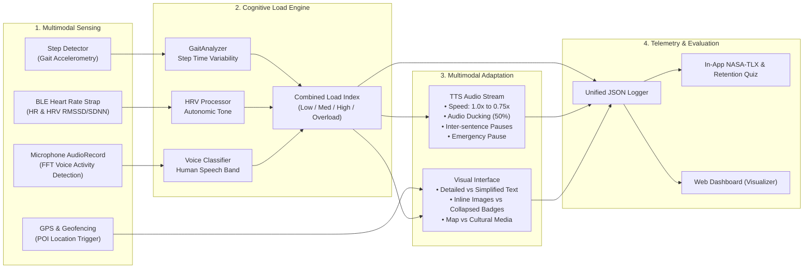
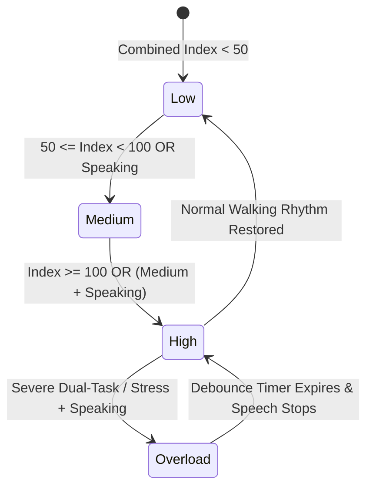

# Graduation Project Presentation Preparation Guide
## Project: CAMCSCHAR (Context-Aware Multimodal Content Selection for Cultural Heritage Augmented Reality)

> **Document Purpose:** This document synthesizes the entire codebase, research foundations, system architecture, and experimental design of the **CAMCSCHAR** project. It directly answers the four core questions required for your graduation project presentation, structured so you can seamlessly convert these sections into presentation slides, speaker notes, and an executive briefing.

---

## Executive Overview at a Glance

| Attribute | Details |
| :--- | :--- |
| **Project Acronym** | **CAMCSCHAR** |
| **Full Title** | Context-Aware Multimodal Content Selection for Cultural Heritage Augmented Reality |
| **Target Platform** | Native Android Application (Kotlin, Jetpack Compose) + Companion Web Visualizer (Next.js, Recharts, Leaflet) |
| **Domain** | Human-Computer Interaction (HCI), Mobile Augmented Reality (AR), Cognitive Ergonomics, Ubiquitous Computing |
| **Testbed Location** | Sabancı University Campus (Amphitheatre, Lake Memorial, Tosun Terzioğlu Garden) |
| **Sensing Inputs** | Smartphone Accelerometry (Gait Dynamics), BLE Heart Rate & Heart Rate Variability (HR/HRV), Microphone FFT (Voice Activity Detection), GPS Geofencing |
| **Adapted Modalities** | Auditory (TTS speed, pauses, audio ducking, script density) & Visual (inline images vs. collapsed clutter-free badges, text complexity, map views) |
| **Evaluation Method** | Empirical A/B User Study ($N=30$), NASA-TLX Subjective Workload, and 18-Question Objective Information Retention Quiz |

---

---

## Question 1: Background, Motivation, and Objectives

### 1.1 Project Background
Augmented Reality (AR) and smart audio guides are increasingly utilized in cultural heritage sites, museum districts, and university campuses to provide self-guided educational explorations. Traditionally, these systems deliver rich historical commentary and visual media via personal smartphones or smart glasses as visitors navigate physically through physical points of interest (POIs).

However, outdoor mobile tours require visitors to perform **dual-tasking**—or even **multi-tasking**:
1. **Primary Physical Task:** Navigating physical terrain, walking along pathways, watching out for steps, traffic, and other pedestrians.
2. **Primary Social Task:** Engaging in conversations with peers or tour companions.
3. **Secondary Informational Task:** Listening to audio narratives, reading on-screen historical facts, and inspecting architectural photos or archival blueprints.

### 1.2 Motivation: The Problem of Cognitive Overload
In conventional tour guide systems, content delivery is **static and blind to the user's mental and physical context**:
* They blast dense, complex audio descriptions at a uniform speed (1.0x), regardless of whether the user is casually standing still or navigating steep outdoor stairs.
* They continuously clutter the phone screen with dense paragraphs of text and large visual imagery, pulling the visitor's visual attention away from the real world.
* When a visitor is spoken to by a friend or needs to ask a question, the static guide keeps talking over them, leading to audio collision and frustration.

According to **Cognitive Load Theory (CLT)**, human working memory has a strictly limited capacity. When external sensory and cognitive demands exceed this capacity:
* **Information Retention Collapses:** Visitors remember little to none of the cultural or historical facts presented to them.
* **Mental Fatigue & Frustration Increase:** The experience transitions from an enjoyable cultural tour into a stressful, mentally demanding chore.
* **Physical Safety is Compromised:** Users experiencing visual and auditory overload while walking outdoors are significantly more prone to tripping, stumbling, or colliding with hazards.

### 1.3 Project Objectives
The objective of **CAMCSCHAR** is to design, implement, and validate a **Context-Aware Multimodal Content Selection (CAMCS)** system for mobile cultural heritage tours that:
1. **Passively and Non-Invasively Estimates Cognitive Load in Real Time:** Employs standard consumer hardware (a smartphone and a lightweight BLE heart rate sensor) to infer mental workload and situational stress without interrupting the user.
2. **Dynamically Modulates Audio & Visual Content Delivery:** Adjusts Text-to-Speech (TTS) parameters (speech rate, inter-sentence delays, volume ducking, and script complexity) and graphical user interface composition (inline images vs. compact tap-to-reveal badges, text density) to match the visitor's instantaneous cognitive capacity.
3. **Improves Information Retention while Lowering Subjective Workload:** Validates through a rigorous empirical A/B user study that dynamic cognitive adaptation leads to measurably higher post-tour quiz scores and significantly reduced NASA-TLX mental demand compared to conventional static tour guides.

### 1.4 The Concept for Non-Specialists (The "Intelligent Co-Pilot" Analogy)
> *Imagine you are driving a car with a friend in the passenger seat who is telling you an elaborate story:*
> * When you are cruising on an empty, straight highway, your friend speaks normally, using detailed descriptions, and shows you a photo on their phone (**Low Load**).
> * When you enter heavy traffic or make an intricate turn, an observant friend naturally pauses, slows down their speaking pace, and waits until you finish the maneuver (**High Load**).
> * If you suddenly start speaking or need to navigate a hazard, they immediately go quiet so you can focus and hear (**Overload / Voice Interruption**).
> 
> **CAMCSCHAR serves as this observant friend for outdoor pedestrian tours—automatically tuning the flow of information so your brain never gets overwhelmed.**

---

## Question 2: What Has Been Accomplished So Far

Since the start of the graduation project, the project has evolved from an initial concept into an **end-to-end, fully functioning mobile prototype, companion research dashboard, and complete empirical evaluation suite**.

### 2.1 Multimodal Sensing Subsystems (Fully Implemented)
The native Android application continuously acquires and processes multimodal physiological and environmental signals:

1. **Gait Dynamics Analysis (Phone Accelerometer):**
   * Implemented in [`GaitAnalyzer.kt`](file:///home/Alar/Desktop/projects/CAMCSCHAR-demo/app/src/main/kotlin/org/example/GaitAnalyzer.kt) and [`GaitSensorManager.kt`](file:///home/Alar/Desktop/projects/CAMCSCHAR-demo/app/src/main/kotlin/org/example/GaitSensorManager.kt).
   * Listens to hardware step-detector interrupts with microsecond timestamps across a sliding window of the last 20 steps.
   * Calculates **Step Time** and **Step Time Variability** ($\sigma_{\text{step}}$) based on the seminal research by *Ho et al. (Nature Scientific Reports, 2019)*, which demonstrated that cognitive load disrupts gait regularity.
   * Features an automatic stationary detector: if a user stops moving for $>5\text{ seconds}$, gait load resets to baseline ($25.0$).

2. **Physiological Monitoring via Bluetooth Low Energy (BLE):**
   * Implemented in [`BleHeartRateManager.kt`](file:///home/Alar/Desktop/projects/CAMCSCHAR-demo/app/src/main/kotlin/org/example/BleHeartRateManager.kt).
   * Interacts directly with standard Bluetooth SIG Heart Rate profile (`0x180D` / `0x2A37`), supporting standard heart rate monitors and chest straps.
   * Extracts real-time Heart Rate (BPM) and raw R-R interval timestamps (beat-to-beat variability).
   * Computes key time-domain Heart Rate Variability (HRV) metrics across a 60-second rolling buffer:
     * **SDNN** (Standard Deviation of NN intervals)
     * **RMSSD** (Root Mean Square of Successive Differences)
   * Grounded in medical and physiological research (*Solhjoo et al., Nature Scientific Reports, 2019*; *Borisov et al., Computers in Human Behavior Reports, 2021*).

3. **Real-Time Voice Activity Detection (Microphone FFT VAD):**
   * Implemented in [`VoiceSensorManager.kt`](file:///home/Alar/Desktop/projects/CAMCSCHAR-demo/app/src/main/kotlin/org/example/VoiceSensorManager.kt).
   * Streams 16-bit PCM audio in 128 ms chunks ($1024$ samples at $8000\text{ Hz}$).
   * Executes an in-place Cooley-Tukey Fast Fourier Transform (FFT) to isolate the human vocal frequency spectrum ($300\text{ Hz} - 3000\text{ Hz}$) versus environmental ambient noise.
   * Triggers when human voice energy exceeds ambient noise by a $1.5\times$ ratio and surpasses a calibrated volume floor ($400\text{ RMS}$), with a $3$-second debouncing cooldown to prevent flutter during natural conversational pauses.

4. **GPS Geofencing & Spatial Orientation:**
   * Implemented in [`LocationSensorManager.kt`](file:///home/Alar/Desktop/projects/CAMCSCHAR-demo/app/src/main/kotlin/org/example/LocationSensorManager.kt) and integrated with **OpenStreetMap (OSMDroid)**.
   * Automatically detects entry into cultural POIs on campus (Amphitheatre, Lake Memorial, Tosun Terzioğlu Garden) with hysteresis boundaries to avoid boundary flickering.
   * Includes an interactive **Manual GPS Debug Mode** for deterministic indoor lab testing and demonstrations.

5. **Eye & Blink Tracking Exploration:**
   * Built and evaluated a computer-vision prototype using Google MLKit Face Detection ([`BlinkSensorManager.kt`](file:///home/Alar/Desktop/projects/CAMCSCHAR-demo/app/src/main/kotlin/org/example/BlinkSensorManager.kt)).
   * Through early testing, determined that front-camera gaze tracking is computationally expensive and ergonomically impractical during outdoor walking (due to variable phone tilt, direct sunlight glare, and battery drain). It was prudently scoped out in favor of the highly reliable gait + cardiac + voice pipeline.

---

### 2.2 Cognitive Load Estimation Model
The system merges multimodal metrics into a continuous normalized **Combined Load Index** ($0 - 100+$) updated every second:

$$\text{Combined Load Index} = \frac{\text{Gait Load Index} + \text{HR Load Index}}{2}$$

* **Gait Score:** Derived from deviations in mean step duration and step time variance.
* **Heart Rate Score:** Normalized instantaneous heart rate relative to baseline plus time-domain HRV indicators (SDNN and RMSSD).
* **Voice Activity State Penalty:** When the participant speaks or is addressed, the classification level is elevated by one tier (e.g., Medium $\rightarrow$ High, High $\rightarrow$ Overload).

#### Load Classification States:

---

### 2.3 Real-Time Dynamic Multimodal Content Adaptation
Implemented in [`TourManager.kt`](file:///home/Alar/Desktop/projects/CAMCSCHAR-demo/app/src/main/kotlin/org/example/TourManager.kt) and [`TTSManager.kt`](file:///home/Alar/Desktop/projects/CAMCSCHAR-demo/app/src/main/kotlin/org/example/TTSManager.kt):

| Cognitive Load Tier | Audio Adaptation (TTS) | Audio Ducking | Inter-Sentence Delay | Visual Layout (UI) | Content Density |
| :--- | :--- | :--- | :--- | :--- | :--- |
| **Low** | Normal Speed (1.0x) | No (100% vol) | 0 ms (Continuous) | Full text + Inline images embedded | Detailed script |
| **Medium** | Slowed Speed (0.75x) | **50% ducked** when user speaks | 1,500 ms pause | Inline images collapsed to "Show Image" buttons | Detailed script |
| **High** | Slowed Speed (0.75x) | **50% ducked** when user speaks | 1,500 ms pause | Collapsed image buttons + simplified phrasing | **Simplified script** |
| **Overload** | **Paused completely** | Muted/Ducked | Tour temporarily halted | Content display paused until recovery | Suspended |

* **Low-Latency In-Stream Audio Modification:** Instead of relying on rigid, pre-synthesized audio files, the system uses custom low-level Android `AudioTrack` streaming with `PlaybackParams`. This enables **instantaneous mid-sentence speed alterations and audio volume ducking** without restarting or cutting off phrases.
* **Dual-Script Architecture:** Each campus POI has two curated, fact-checked textual scripts:
  * *Detailed Script:* Eloquent, lexically complex, rich architectural and historical vocabulary.
  * *Simplified Script:* Clear, direct, digestible sentences optimized for high-load working memory.

---

### 2.4 Experimental Framework & Built-in In-App Evaluation
To enable rigorous scientific evaluation, the app includes a self-contained experimental test framework:

1. **A/B Testing Switch:**
   * **Control Group (Static Mode):** Plays the detailed script continuously at 1.0x speed with static images and text regardless of user stress or voice activity.
   * **Experimental Group (Auto Mode):** Continuously adapts speed, pausing, ducking, layout, and script complexity based on real-time load.
2. **Complete In-App Post-Tour Survey Screen ([`RetentionSurveyScreen.kt`](file:///home/Alar/Desktop/projects/CAMCSCHAR-demo/app/src/main/kotlin/org/example/RetentionSurveyScreen.kt)):**
   * **NASA-TLX (Task Load Index):** Standardized 6-dimension subjective assessment (Mental Demand, Physical Demand, Temporal Demand, Performance, Effort, Frustration) scored on 0–100 scales.
   * **18-Question Objective Information Retention Quiz:**
     * 12 Core Knowledge Questions (assessing basic understanding across POIs).
     * 6 Detailed Nuance Questions (testing whether complex historical facts are retained during different stress levels).
     * 2 Embedded Attention Check questions to ensure participant validity.
     * High-resolution question response timing (measures hesitation and time-spent per question).
3. **Data Logging & Export Pipeline ([`ExperimentDataManager.kt`](file:///home/Alar/Desktop/projects/CAMCSCHAR-demo/app/src/main/kotlin/org/example/ExperimentDataManager.kt)):**
   * Logs time-stamped sensor telemetry, state transitions, GPS coordinates, and quiz answers into a unified JSON file.
   * Offers one-tap direct saving to the device's public `Downloads` folder and automated HTTP POST upload to the research dashboard server.

---

### 2.5 The Academic Companion Visualizer Dashboard
A dedicated web application was developed in the [`visualizer/`](file:///home/Alar/Desktop/projects/CAMCSCHAR-demo/visualizer) directory using **Next.js 15, React 19, Recharts, and Leaflet**:
* **Synchronized Telemetry Graphing:** Plots Heart Rate, HRV (RMSSD), Step Time Variance, and Combined Load Index on multi-axis timelines.
* **Interactive Event Log:** Highlights exactly when state changes occurred (e.g., when the user started speaking, entered a POI, or when the system ducked audio).
* **GPS Route Mapping:** Visualizes participant trajectories over the Sabancı University campus.
* **Survey & Score Cards:** Summarizes participant retention scores (Overall, Core, Detailed) alongside NASA-TLX workload dimensions.

---

## Question 3: Next Steps to Complete the Project This Semester

With the software infrastructure, sensing pipelines, content, and survey instruments fully constructed, the project is positioned for final refinement, formal testing, and academic analysis.

### 3.1 Software Polish & Stabilization
* [ ] **TTS Utterance Synchronization:** Eliminate the minor edge-case latency where clicking the manual "Next" button occasionally lags behind the displayed script index.
* [ ] **UI Transitions & Micro-Interactions:** Add smooth layout transition animations when inline images expand or collapse to minimize visual jarring.
* [ ] **Gallery Swiping:** Implement gesture swiping inside the expanded image mode to allow participants to browse multiple archival photos smoothly.
* [ ] **Sensor Noise Debouncing:** Finalize dampening filters on edge threshold transitions to ensure the system does not rapidly toggle between Medium and High when scores hover near 50.0 or 100.0.

### 3.2 Field Calibration & Pilot Testing
* [ ] **Campus Route Walkthroughs:** Perform dry runs along the Sabancı University route (Amphitheatre $\rightarrow$ Lake Memorial $\rightarrow$ Tosun Terzioğlu Garden) across different times of day to ensure GPS geofence stability under tree cover and verify microphone threshold performance against ambient wind noise.
* [ ] **BLE Sensor Pairing Validation:** Ensure resilient auto-reconnect handling if the BLE heart rate monitor temporarily drops connection during walking.

### 3.3 Formal Human Subjects Study ($N=30$)
* [ ] **Participant Recruitment:** Recruit 30 healthy student volunteers (aged 18–35).
* [ ] **Execution of Controlled A/B Protocol:**
  * 15 participants in the **Control Condition** (Static tour guide).
  * 15 participants in the **Experimental Condition** (Dynamic CAMCS adaptation).
* [ ] **Standardized Stressor Induction Across 4 Route Phases:**
  * *Phase 1 (Amphitheatre):* Baseline low-stress walking.
  * *Phase 2 (Lake Memorial):* Social verbal interaction stressor (researcher engages in standardized dialogue).
  * *Phase 3 (Tosun Terzioğlu Garden):* Physical terrain navigation + cognitive dual-task (counting backward while walking).
  * *Phase 4 (Cognitive Overload):* Stair climbing combined with rapid-fire questioning.

### 3.4 Data Analysis & Hypothesis Verification
* [ ] **Statistical Testing:**
  * Conduct two-tailed independent-samples t-tests (or Mann-Whitney U tests) comparing NASA-TLX mental demand scores between Control and Experimental groups.
  * Analyze Information Retention scores across Core vs. Detailed questions, specifically evaluating whether the dynamic simplified script preserved retention during high-load phases.
* [ ] **State Transition Accuracy Evaluation:** Quantify the percentage of time the multimodal model accurately detected induced environmental stressors.

### 3.5 Final Graduation Deliverables
* [ ] **Comprehensive Graduation Project Thesis / Report:** Documenting the literature review, engineering implementation, experimental results, and HCI contributions.
* [ ] **Demonstration Video & Interactive Presentation:** Creating high-definition screen captures and on-campus video footage illustrating the system adapting in real time to present at the final graduation symposium.

---

## Question 4: Presenting to an Interdisciplinary Audience

When presenting to students and faculty members from departments outside Computer Science (e.g., Humanities, Industrial Engineering, Biological Sciences, Management), avoid excessive code-level jargon. Use these principles and slide narratives:

### 4.1 Plain-Language Explanations of Core Technical Concepts

| Technical Term | Everyday Translation for General Audiences |
| :--- | :--- |
| **Cognitive Load (CL)** | Mental bandwidth or "RAM of the human brain"—how much mental effort you are expending right now. |
| **Multimodal Sensing** | Using multiple senses at once (movement, heart rhythm, hearing) to form a complete picture of the user's situation. |
| **Step Time Variability** | Walking rhythm regularity. When people concentrate hard or get distracted, their steady walking rhythm stumbles or becomes uneven. |
| **Heart Rate Variability (HRV)** | The microscopic variations in time between heartbeats, reflecting autonomic nervous system stress and cognitive effort. |
| **Voice Activity Detection (FFT)** | A digital ear that can tell the difference between background wind noise and an actual human voice. |
| **Audio Ducking** | Automatically lowering background audio volume when someone begins speaking, similar to a car radio lowering music when GPS navigation gives directions. |
| **Geofencing** | An invisible digital boundary on a map that triggers location-specific stories when you step inside it. |
| **NASA-TLX** | The gold-standard NASA scientific questionnaire used to measure subjective mental and physical workload. |

---

### 4.2 Recommended Slide-by-Slide Presentation Structure

#### Slide 1: Title & Hook
* **Title:** CAMCSCHAR: Making Outdoor Augmented Reality Tours Smarter and Stress-Free
* **Subtitle:** Context-Aware Multimodal Content Selection for Cultural Heritage AR
* **Visual:** Photo/render of someone walking on campus wearing earphones, looking at the app, with subtle biometric indicator overlays.
* **Speaker Script:** *"Have you ever tried listening to an educational podcast or audio guide while walking through an unfamiliar area, only to realize after five minutes that you didn't remember a single word because you were busy navigating stairs, watching your step, or talking to a friend? Our project solves that exact problem."*

#### Slide 2: The Core Problem (Dual-Tasking & Cognitive Overload)
* **Visual:** Split graphic: A person bombarded by phone notifications and dense text while walking vs. a simplified view of human working memory getting overloaded.
* **Key Point:** Human attention is finite. Current mobile AR guides blast information blindly, creating cognitive overload, missed learning opportunities, and safety hazards.

#### Slide 3: Our Solution: The CAMCS Concept
* **Visual:** The high-level loop: **Sense** (biometrics) $\rightarrow$ **Estimate** (mental load) $\rightarrow$ **Adapt** (audio & visual content).
* **Key Point:** A tour guide app that acts like an attentive human companion—slowing down, pausing, or summarizing when you need to focus on walking.

#### Slide 4: How the App Senses Your Context (Multimodal Sensing)
* **Visual:** Icons for Smartphone Accelerometer, BLE Heart Rate Strap, and Phone Microphone.
* **Key Point:** 100% non-invasive, lightweight consumer sensors:
  * Phone measures walking rhythm (gait variability).
  * Heart rate sensor monitors stress response (HR & HRV).
  * Microphone detects when you or someone else is talking using frequency analysis.

#### Slide 5: The Cognitive Load Estimation Engine
* **Visual:** A clear gauge / dial moving from **Low** $\rightarrow$ **Medium** $\rightarrow$ **High** $\rightarrow$ **Overload**.
* **Key Point:** We combine these physical and biological signals into an instantaneous index that accurately mirrors the user's cognitive state.

#### Slide 6: Dynamic Content Adaptation in Action
* **Visual:** Before/After side-by-side comparison:
  * *Low Load:* Detailed architectural history, 1.0x speech rate, rich inline photos.
  * *High Load:* Simplified bullet-point narration, 0.75x speed with 1.5s pauses, uncluttered screen with optional tap-to-expand badges.
  * *Overload / Talking:* Automatic audio ducking and emergency pause.

#### Slide 7: Real-World Testbed: Sabancı University Campus
* **Visual:** Campus map showing the 3 test POIs (Amphitheatre $\rightarrow$ Lake Memorial $\rightarrow$ Tosun Terzioğlu Garden) and real screenshots from the app.
* **Key Point:** Authentic cultural heritage content, GPS-triggered geofencing, and historical scripts specifically created and fact-checked for this testbed.

#### Slide 8: The Research Dashboard & Experimental Framework
* **Visual:** Screenshot of the companion Next.js web visualizer displaying synchronized heart rate and step variance charts alongside the in-app NASA-TLX survey.
* **Key Point:** Built a complete scientific apparatus for collecting, visualizing, and analyzing live experiment data.

#### Slide 9: Experimental Design ($N=30$ A/B User Study)
* **Visual:** A/B study diagram: Control Group (Static Guide) vs. Experimental Group (Adaptive Guide) across the 4 route phases.
* **Key Point:** Evaluating retention through an 18-question post-tour quiz and mental workload through NASA-TLX.

#### Slide 10: Next Steps to Completion
* **Visual:** Timeline / Milestone roadmap for the remainder of the semester:
  1. Software polish & debounce tuning.
  2. Running the 30-participant study on campus.
  3. Statistical data analysis.
  4. Final thesis report and symposium showcase.

#### Slide 11: Summary & Broader Impact
* **Visual:** Summary graphic showing applications beyond campus tours (museums, smart tourism, industrial maintenance, emergency response training).
* **Key Point:** Proves that mobile computing can adapt to human cognitive limitations in the real world, creating safer, more memorable experiences.

---

### 4.3 Anticipated Questions from Cross-Program Faculty & Suggested Answers

> **Q1 (From a Humanities / Arts faculty member):** *"Does simplifying the text during high-load periods reduce the cultural value of the tour?"*
> **Answer:** *"Actually, pedagogical research shows the opposite. When a visitor's working memory is overwhelmed, they retain almost nothing from a dense, complex lecture. By temporarily switching to concise core facts when the user is climbing stairs or talking, we ensure they retain the essential cultural history rather than tuning out entirely."*

> **Q2 (From a Biology / Psychology faculty member):** *"Why use both gait and heart rate? Isn't heart rate alone enough to measure cognitive load?"*
> **Answer:** *"Heart rate and HRV are excellent indicators of autonomic nervous system activation, but outdoor walking introduces physical exertion artifacts. By combining cardiac signals with accelerometer-based step time variability and voice detection, we can isolate mental and dual-task load from pure physical walking pace."*

> **Q3 (From an Engineering / CS faculty member):** *"Why did you opt for in-place AudioTrack streaming instead of generating two separate audio files beforehand?"*
> **Answer:** *"Pre-recorded audio files cannot adjust their playback speed or pause dynamically in the middle of a sentence without sounding disjointed or restarting. By feeding real-time text-to-speech PCM audio into an Android AudioTrack stream, we can alter `PlaybackParams` mid-word and duck volume instantaneously when the user speaks."*

> **Q4 (From a Management / Business faculty member):** *"Is requiring a BLE chest strap practical for real tourists in the future?"*
> **Answer:** *"For our academic study, the BLE monitor provides clinical-grade ground truth for heart rate and HRV. However, the system is modular: the gait accelerometry and microphone VAD run entirely on standard smartphones. Furthermore, modern smartwatches (Apple Watch, WearOS) already provide BLE heart rate streaming, making commercial adoption seamless."*

---

## File and Component Reference Index

For your reference during the presentation or demo preparation, here are the direct links to the key files in the codebase:

* **Sensing & Analysis Engine:**
  * [`GaitAnalyzer.kt`](file:///home/Alar/Desktop/projects/CAMCSCHAR-demo/app/src/main/kotlin/org/example/GaitAnalyzer.kt) – Core gait variance & cognitive load calculation algorithm.
  * [`GaitSensorManager.kt`](file:///home/Alar/Desktop/projects/CAMCSCHAR-demo/app/src/main/kotlin/org/example/GaitSensorManager.kt) – Step detector sensor listener.
  * [`BleHeartRateManager.kt`](file:///home/Alar/Desktop/projects/CAMCSCHAR-demo/app/src/main/kotlin/org/example/BleHeartRateManager.kt) – Bluetooth Low Energy GATT client for HR & R-R intervals.
  * [`VoiceSensorManager.kt`](file:///home/Alar/Desktop/projects/CAMCSCHAR-demo/app/src/main/kotlin/org/example/VoiceSensorManager.kt) – Microphone 16-bit PCM streaming & Cooley-Tukey FFT voice detector.
  * [`LocationSensorManager.kt`](file:///home/Alar/Desktop/projects/CAMCSCHAR-demo/app/src/main/kotlin/org/example/LocationSensorManager.kt) – GPS provider integration and coordinate tracking.
* **Adaptation & Audio/Visual Delivery:**
  * [`TourManager.kt`](file:///home/Alar/Desktop/projects/CAMCSCHAR-demo/app/src/main/kotlin/org/example/TourManager.kt) – Central orchestrator for POIs, script states, and load transitions.
  * [`TTSManager.kt`](file:///home/Alar/Desktop/projects/CAMCSCHAR-demo/app/src/main/kotlin/org/example/TTSManager.kt) – Dynamic low-latency audio track synthesis, mid-flight speed & ducking control.
  * [`MainActivity.kt`](file:///home/Alar/Desktop/projects/CAMCSCHAR-demo/app/src/main/kotlin/org/example/MainActivity.kt) – Jetpack Compose UI layout, OSMDroid map rendering, and debug dashboards.
* **Evaluation & Experiment Management:**
  * [`RetentionSurveyModel.kt`](file:///home/Alar/Desktop/projects/CAMCSCHAR-demo/app/src/main/kotlin/org/example/RetentionSurveyModel.kt) – NASA-TLX dimensions, 18 retention quiz questions, and scoring logic.
  * [`RetentionSurveyScreen.kt`](file:///home/Alar/Desktop/projects/CAMCSCHAR-demo/app/src/main/kotlin/org/example/RetentionSurveyScreen.kt) – In-app survey interface and submission handling.
  * [`ExperimentDataManager.kt`](file:///home/Alar/Desktop/projects/CAMCSCHAR-demo/app/src/main/kotlin/org/example/ExperimentDataManager.kt) – Telemetry JSON serialization, file persistence, and HTTP upload.
  * [`visualizer/src/components/Dashboard.tsx`](file:///home/Alar/Desktop/projects/CAMCSCHAR-demo/visualizer/src/components/Dashboard.tsx) – Academic Next.js research telemetry dashboard.
* **Experimental Protocol & Documentation:**
  * [`scenario.md`](file:///home/Alar/Desktop/projects/CAMCSCHAR-demo/scenario.md) – Campus test route, stressor phases, and experimental methodology.
  * [`retention_survey.md`](file:///home/Alar/Desktop/projects/CAMCSCHAR-demo/retention_survey.md) – Complete questionnaire reference and quiz key.
  * [`TODO`](file:///home/Alar/Desktop/projects/CAMCSCHAR-demo/TODO) – Actionable bug tracker and completion checklist.
